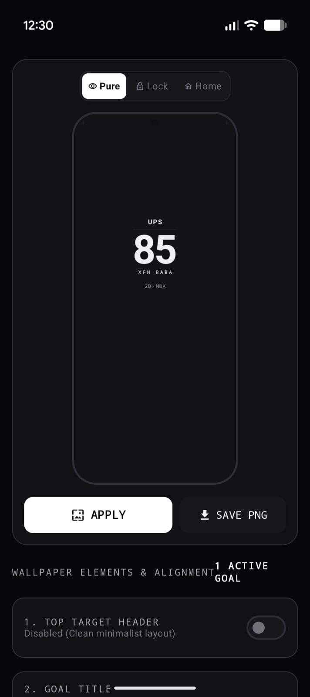
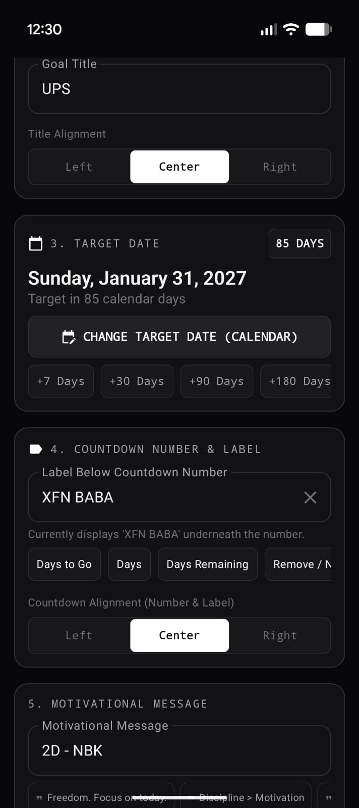
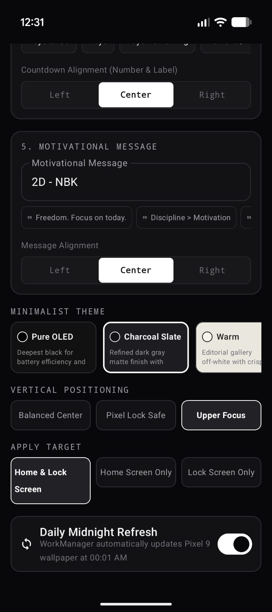

# Day Reminder – Personal Goal Countdown

A simple Android application built to turn personal goals into everyday visual reminders.

Day Reminder is a personal project that transforms a mobile wallpaper into a continuously updated reminder of the goals, milestones, and targets that matter to you.

Instead of relying on occasional reminders, the idea is to keep your goals visible every time you look at your phone.

## ✨ Key Features

- **Live Goal Countdown:** Displays the number of days remaining until your selected target date.
- **Automatic Daily Updates:** The countdown updates every day at midnight.
- **Personalized Text:** Add short motivational messages, personal notes, or reminders.
- **Multiple Countdown Views:** View the remaining time in days, weeks, and other available formats.
- **Personalized Experience:** Customize the displayed text to reflect your goals and priorities.

## 🎯 Why I Built This

I wanted a simple way to keep my long-term goals visible throughout the day.

The idea was to turn something I look at dozens of times every day – my phone wallpaper – into a small but consistent source of motivation.

This application started as a fun personal experiment and my first hands-on step into Android application development.

## 🛠️ Built With

- [Google AI Studio](https://aistudio.google.com/) – AI-assisted application development
- Android – Mobile application platform

## 🚀 Project Status

An initial working version has been developed and installed on my Android device.

This is an experimental personal project. I may continue improving its features, design, and functionality as I explore Android development.

## 💡 What's Next?

Potential future improvements include additional customization options, improved visual designs, and more ways to personalize goal reminders.

## UI

---

**Built for personal use, learning, and the pursuit of meaningful goals.**
